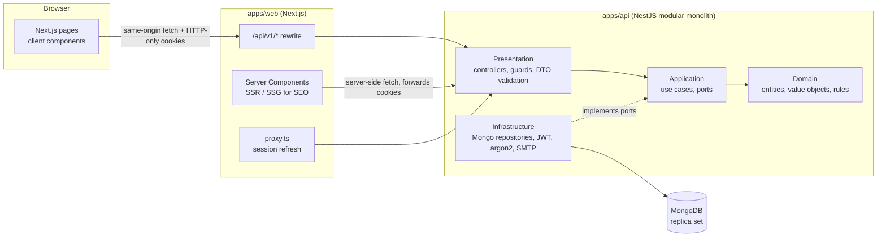
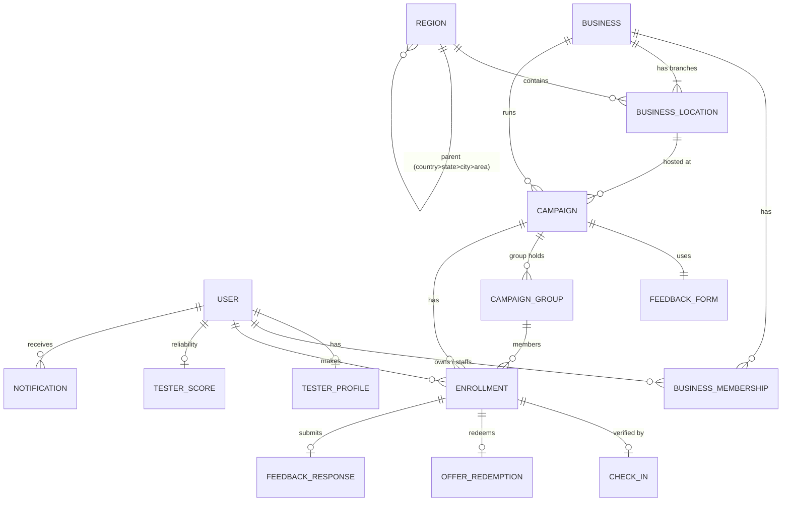
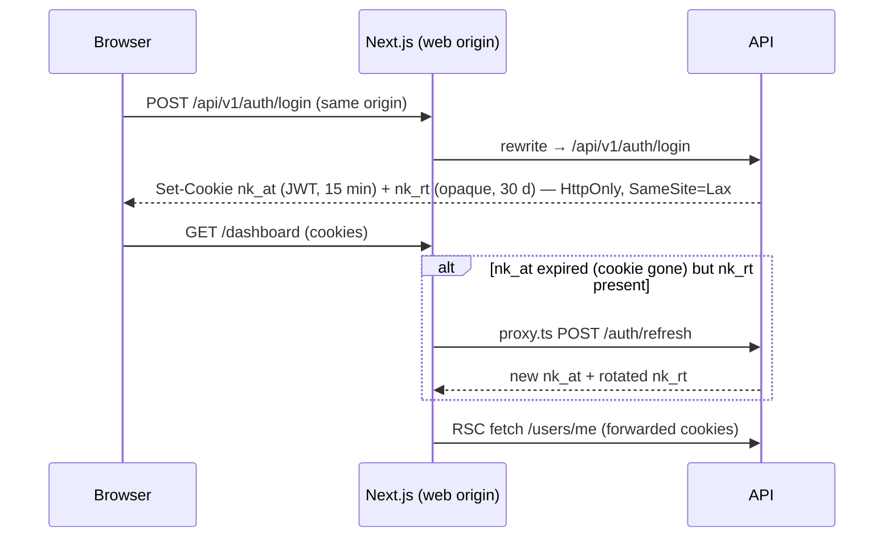
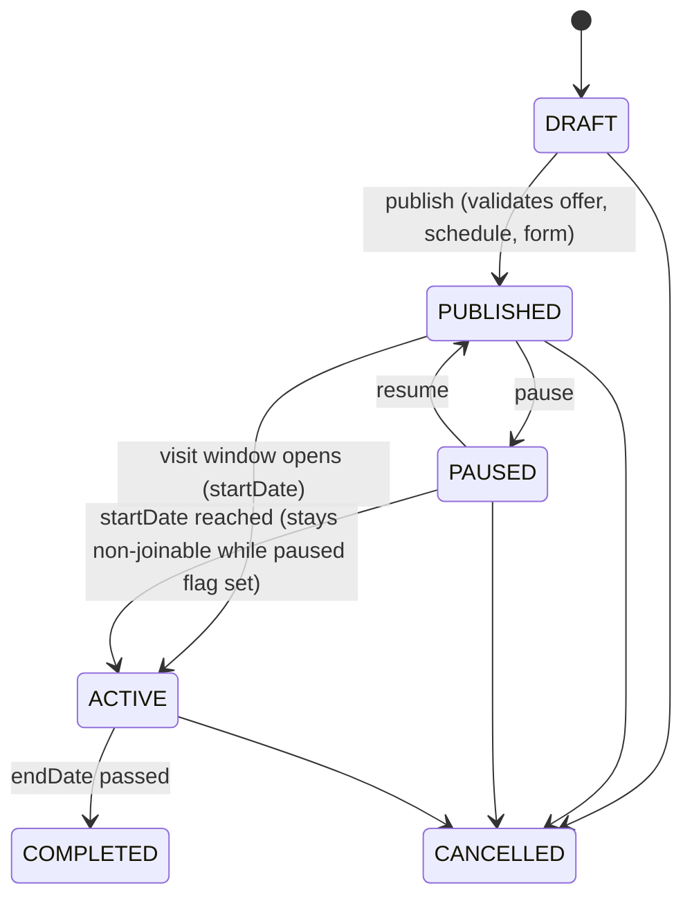
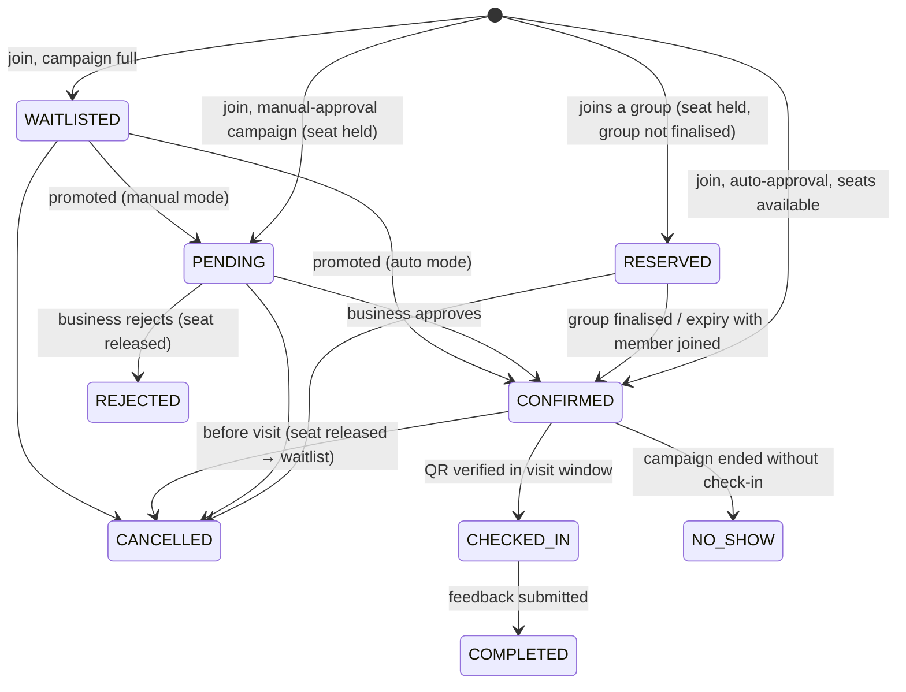

# Architecture

This document is the architecture review requested before implementation (sections **A–J**), kept up to date
as the system grows. Sections marked **(implemented)** exist in code; **(designed)** sections are the agreed
design for upcoming phases.

Guiding priority: **correctness > simplicity > maintainability > scalability > premature optimisation.**

---

## A. Recommended architecture

**A modular monolith** (NestJS API + Next.js web) in a pnpm/Turborepo monorepo, with **clean/hexagonal
layering inside each module** and MongoDB as the system of record.



**Why this shape**

| Decision                             | Reason                                                                                                                                                                                                                  |
| ------------------------------------ | ----------------------------------------------------------------------------------------------------------------------------------------------------------------------------------------------------------------------- |
| Modular monolith, not microservices  | One deployable, one database, real transactions. Module boundaries give most of the benefits of services; a module can be extracted later because it only talks to others through exported ports/use cases.             |
| Clean architecture per module        | Capacity, enrollment and reputation rules are the product. Keeping them in framework-free domain code makes them unit-testable in milliseconds and safe to change.                                                      |
| Repository ports owned by the domain | Use cases depend on `CampaignRepository`, never on Mongoose. Concurrency-critical operations get **intention-revealing repository methods** (e.g. `tryReserveSeats`) so atomic Mongo operations stay in infrastructure. |
| NestJS 11                            | Mature DI, guards and pipes. Pinned to 11 (CommonJS) because Nest 12 is ESM-only and the DI relies on decorator metadata.                                                                                               |
| Next.js 16 App Router                | Server rendering/static generation for local SEO, plus the same codebase for mobile-first dashboards.                                                                                                                   |
| MongoDB (replica set)                | Flexible documents for campaigns/forms, 2dsphere geo queries for "near me", multi-document transactions for enrollment. Dev runs a single-node replica set so transactions behave as in production.                     |
| Shared contracts package             | `@nokkam/shared-types` holds **only** wire contracts (DTO types, enums, zod request schemas). The web and API validate with the same schema; no server internals leak to the client.                                    |

---

## B. Folder structure

```
nokkam/
├─ apps/
│  ├─ api/
│  │  ├─ src/
│  │  │  ├─ main.ts                       bootstrap
│  │  │  ├─ app.module.ts                 composition root (modules, global guards/filters)
│  │  │  ├─ bootstrap/configure-app.ts    HTTP pipeline shared with e2e tests
│  │  │  ├─ scripts/seed-admin.ts
│  │  │  ├─ shared/                       ── shared kernel ──
│  │  │  │  ├─ domain/                    AppError taxonomy, Email VO, UserRole
│  │  │  │  ├─ application/               ports: Clock, IdGenerator, TransactionManager, AuditLog; Actor
│  │  │  │  ├─ infrastructure/            Mongo module, ALS transaction manager, UUIDv7, audit log
│  │  │  │  ├─ presentation/http/         exception filter, envelope interceptor, zod pipe,
│  │  │  │  │                             @Public/@Roles/@CurrentActor, RolesGuard, Origin check
│  │  │  │  ├─ config/                    zod-validated env → typed AppConfig
│  │  │  │  └─ logging/                   pino + request ids
│  │  │  └─ modules/
│  │  │     ├─ auth/          { domain, application/ports, infrastructure, presentation }
│  │  │     ├─ users/         { domain, application, infrastructure, presentation }
│  │  │     ├─ notifications/ { application (EmailSender port), infrastructure (log/SMTP) }
│  │  │     ├─ admin/         { application, presentation }
│  │  │     ├─ health/
│  │  │     │  ── upcoming (same 4-layer layout) ──
│  │  │     ├─ regions/  businesses/  campaigns/  enrollments/  groups/
│  │  │     ├─ check-ins/  offers/  feedback/  reputation/
│  │  └─ test/
│  │     ├─ support/       in-memory replica set, fakes, test app factory
│  │     ├─ integration/   *.int-spec.ts  (repositories, transactions, races)
│  │     └─ e2e/           *.e2e-spec.ts  (HTTP flows)
│  │     (unit tests live next to the code: src/**/*.spec.ts)
│  └─ web/
│     └─ src/
│        ├─ app/
│        │  ├─ (public)/        home, later: campaigns/, businesses/, [city]/…  (SSG/ISR, indexable)
│        │  ├─ (auth)/          login, register, verify-email                   (noindex)
│        │  ├─ dashboard/       tester/, business/, admin/                       (dynamic, noindex)
│        │  ├─ robots.ts  sitemap.ts  not-found.tsx  layout.tsx  globals.css (design tokens)
│        ├─ components/   ui/ (Button, FormField, Alert…), navigation/
│        ├─ features/     auth/, dashboard/   (later: campaigns/, enrollment/, groups/, feedback/)
│        ├─ lib/          api/ (client.ts browser, server.ts RSC), seo/, config.ts
│        └─ proxy.ts      optimistic session refresh for /dashboard
├─ packages/
│  ├─ shared-types/   API contracts (no server code)
│  ├─ tsconfig/       base / library / nest / nextjs
│  └─ eslint-config/  base / nest / next (flat config)
├─ docker/ · docker-compose.yml · turbo.json · pnpm-workspace.yaml · .env.example
```

### Module dependency rules

- A module's **domain** imports only `shared/domain` (and its own files).
- **Application** imports its own domain, shared ports, and other modules' **domain ports**
  (e.g. auth uses `UserRepository`). It never imports another module's infrastructure.
- **Infrastructure** implements ports and is wired in the module file (`{ provide: Port, useClass: Adapter }`).
- Cross-module calls go through exported providers listed in the Nest module's `exports`.
- Application classes carry `@Injectable()`. That decorator is inert metadata and the only framework touch
  allowed there, a deliberate pragmatism. Use cases are still constructed directly with fakes in unit tests.

---

## C. Core domain model



| Aggregate                                            | Module        | Key responsibility / invariants                                                                                                                                                                                                             |
| ---------------------------------------------------- | ------------- | ------------------------------------------------------------------------------------------------------------------------------------------------------------------------------------------------------------------------------------------- |
| **User** _(implemented)_                             | users         | Identity, credentials, roles, status, email verification. Kept small; profile data lives elsewhere.                                                                                                                                         |
| **RefreshSession**, **AccountToken** _(implemented)_ | auth          | Rotating refresh-token chains; single-use expiring email tokens.                                                                                                                                                                            |
| TesterProfile                                        | users         | Preferred region, home coordinates, birth year (for eligibility), interests.                                                                                                                                                                |
| Business + BusinessMembership                        | businesses    | A business has **members with roles** (OWNER, MANAGER, STAFF), not a single `ownerId`, so multiple owners and staff accounts need no redesign. Verification status.                                                                         |
| BusinessLocation                                     | businesses    | Branch: address, `regionId`, GeoJSON point. A business has 1..n.                                                                                                                                                                            |
| Region                                               | regions       | Hierarchy (COUNTRY > STATE > CITY > AREA), `slug` and `path` for SEO URLs, optional centroid.                                                                                                                                               |
| **Campaign**                                         | campaigns     | Offer (regular/campaign price, currency, money as integer minor units), capacity counters, `maxGroupSize`, schedule (dates + daily visit window + timezone), eligibility, approval mode, lifecycle status. Owns the **capacity invariant**. |
| CampaignGroup                                        | groups        | Leader, requested size, invite code, `expiresAt`, held seats. Owns **reservation/expiry** rules.                                                                                                                                            |
| **Enrollment**                                       | enrollments   | One per (campaign, user) participation. Owns the **enrollment state machine**.                                                                                                                                                              |
| CheckIn                                              | check-ins     | Tester, campaign, business, location, timestamp, method (QR now; POS later via `CheckInVerifier` port).                                                                                                                                     |
| OfferRedemption                                      | offers        | Created after check-in. `OfferRedemptionProvider` port leaves room for POS, wallet, cashback.                                                                                                                                               |
| FeedbackForm / FeedbackResponse                      | feedback      | Versioned questions (RATING, TEXT, YES_NO, SINGLE_CHOICE, MULTI_CHOICE). Responses are **private** to the business and admins.                                                                                                              |
| TesterScore                                          | reputation    | Counters (completed, cancellations, no-shows, feedback completion) → `reliabilityScore` (0–100). Pure scoring function, so the formula can evolve.                                                                                          |
| Notification                                         | notifications | In-app inbox and channel dispatch (email now; SMS/WhatsApp/push later via channel ports).                                                                                                                                                   |

**Shared kernel value objects:** `Email` _(implemented)_, `Money` (integer minor units + ISO currency),
`GeoPoint`, `DateRange`, `TimeWindow`, `UserRole` _(implemented)_.

**Identifiers:** UUIDv7 strings generated by the application _(implemented)_. They are time-ordered (good B-tree
locality), non-enumerable, and Mongo ObjectIds never appear in the API. Public pages use **slugs**.

---

## D. MongoDB schema & index strategy

Principles: one collection per aggregate; **reference** things that grow independently (enrollments, responses,
check-ins are never embedded in a campaign); **embed** small bounded value objects (offer, schedule,
eligibility); **denormalise** read-critical fields (campaign keeps a copy of its location point and `regionId`
for geo discovery); a `version` field gives optimistic concurrency on aggregates _(implemented for users)_.

| Collection                   | Key fields                                                                                                                                                                   | Indexes                                                                                                                                                                                   |
| ---------------------------- | ---------------------------------------------------------------------------------------------------------------------------------------------------------------------------- | ----------------------------------------------------------------------------------------------------------------------------------------------------------------------------------------- |
| `users` _(impl.)_            | email, passwordHash, roles[], status, emailVerifiedAt, version                                                                                                               | `{email:1}` **unique** · `{createdAt:-1,_id:-1}` (admin paging) · `{roles:1,status:1}`                                                                                                    |
| `refresh_sessions` _(impl.)_ | familyId, userId, tokenHash, expiresAt, rotatedAt, revokedAt                                                                                                                 | `{tokenHash:1}` **unique** · `{familyId:1}` · `{userId:1}` · `{expiresAt:1}` **TTL**                                                                                                      |
| `account_tokens` _(impl.)_   | userId, purpose, tokenHash, expiresAt, consumedAt                                                                                                                            | `{tokenHash:1}` **unique** · `{userId:1,purpose:1}` · `{expiresAt:1}` **TTL**                                                                                                             |
| `audit_logs` _(impl.)_       | actorId, action, resource, metadata, requestId, ip                                                                                                                           | `{actorId:1,createdAt:-1}` · `{resourceType:1,resourceId:1,createdAt:-1}` · `{action:1,createdAt:-1}`                                                                                     |
| `regions`                    | type, name, slug, parentId, path, centroid                                                                                                                                   | `{slug:1}` **unique** · `{parentId:1}` · `{path:1}`                                                                                                                                       |
| `tester_profiles`            | userId, regionId, home (GeoJSON), birthYear, interests                                                                                                                       | `{userId:1}` **unique**                                                                                                                                                                   |
| `businesses`                 | name, slug, categoryId, verificationStatus, members[] (bounded)                                                                                                              | `{slug:1}` **unique** · `{"members.userId":1}` · `{status:1}`                                                                                                                             |
| `business_locations`         | businessId, regionId, address, point                                                                                                                                         | `{businessId:1}` · `{regionId:1}` · `{point:"2dsphere"}`                                                                                                                                  |
| `campaigns`                  | businessId, locationId, regionId, point, slug, status, offer, capacity{total,reserved,confirmed}, maxGroupSize, schedule, eligibility, approvalMode, feedbackFormId, version | `{businessId:1,status:1}` · `{slug:1}` **unique** · `{status:1,regionId:1,"schedule.endDate":1}` (city/area pages) · `{point:"2dsphere",status:1}` (near-me) · `{"schedule.startDate":1}` |
| `campaign_groups`            | campaignId, leaderId, size, inviteCode, status, expiresAt                                                                                                                    | `{inviteCode:1}` **unique** · `{campaignId:1}` · `{status:1,expiresAt:1}` (expiry sweeper)                                                                                                |
| `enrollments`                | campaignId, userId, groupId, partySize, status, timestamps per state                                                                                                         | `{campaignId:1,userId:1}` **unique partial** (only "live" statuses) · `{userId:1,status:1}` · `{campaignId:1,status:1,createdAt:1}` (participants list, waitlist order) · `{groupId:1}`   |
| `check_ins`                  | enrollmentId, campaignId, businessId, userId, method, at                                                                                                                     | `{enrollmentId:1}` **unique** · `{campaignId:1,at:-1}`                                                                                                                                    |
| `offer_redemptions`          | enrollmentId, campaignId, provider, at                                                                                                                                       | `{enrollmentId:1}` **unique**                                                                                                                                                             |
| `feedback_forms`             | campaignId, version, questions[]                                                                                                                                             | `{campaignId:1,version:-1}`                                                                                                                                                               |
| `feedback_responses`         | campaignId, businessId, enrollmentId, userId, formVersion, answers[]                                                                                                         | `{enrollmentId:1}` **unique** · `{campaignId:1,createdAt:-1}` · `{businessId:1,createdAt:-1}`                                                                                             |
| `tester_scores`              | userId, counters, score                                                                                                                                                      | `{userId:1}` **unique** · `{score:-1}`                                                                                                                                                    |
| `notifications`              | userId, type, payload, readAt                                                                                                                                                | `{userId:1,createdAt:-1}` · `{userId:1,readAt:1}`                                                                                                                                         |

Index lifecycle: `autoIndex` is on in development and tests, **off in production**. Indexes are built by a
deliberate release step, so a deploy never triggers an unplanned index build on a large collection.

---

## E. API endpoint design

Full contract in [API.md](API.md). Conventions: `/api/v1`, plural nouns, actions as sub-resources
(`POST /campaigns/:id/publish`), `{ data, meta? }` / `{ error }` envelopes, keyset pagination (`?cursor=`),
422 for validation and rule violations, stable machine-readable `error.code`.

| Area       | Endpoints                                                                                                                                                                                                                                                         | Phase   |
| ---------- | ----------------------------------------------------------------------------------------------------------------------------------------------------------------------------------------------------------------------------------------------------------------- | ------- |
| Auth       | `POST /auth/register` · `/auth/login` · `/auth/refresh` · `/auth/logout` · `/auth/verify-email` · `/auth/verify-email/resend`                                                                                                                                     | **1 ✓** |
| Users      | `GET /users/me` · `PATCH /users/me/profile` · `PUT /users/me/location`                                                                                                                                                                                            | 1 ✓ / 2 |
| Admin      | `GET /admin/users` · `POST /admin/users/:id/suspend` · `/reactivate` · `/admin/businesses` · `/admin/campaigns` · `/admin/reports`                                                                                                                                | 1 ✓ / 6 |
| Discovery  | `GET /campaigns?near=lat,lng&radiusKm=&region=&category=` · `GET /campaigns/:slug` · `GET /regions/:slug/campaigns` · `GET /businesses/:slug`                                                                                                                     | 2       |
| Enrollment | `POST /campaigns/:id/join` (`{partySize}`) · `DELETE /enrollments/:id` · `GET /users/me/enrollments`                                                                                                                                                              | 2       |
| Groups     | `POST /groups` · `GET /groups/:inviteCode` · `POST /groups/:id/join` · `POST /groups/:id/invite` · `POST /groups/:id/confirm`                                                                                                                                     | 2       |
| Business   | `POST /businesses` · `PATCH /businesses/:id` · `POST /businesses/:id/locations` · `POST /campaigns` · `PATCH /campaigns/:id` · `POST /campaigns/:id/{publish,pause,resume,cancel}` · `GET /campaigns/:id/participants` · `POST /enrollments/:id/{approve,reject}` | 3       |
| Visit      | `POST /check-ins` (QR payload) · `POST /offers/:enrollmentId/redeem` · `GET /campaigns/:id/check-in-code`                                                                                                                                                         | 4       |
| Feedback   | `PUT /campaigns/:id/feedback-form` · `POST /feedback` · `GET /campaigns/:id/feedback` · `GET /campaigns/:id/insights`                                                                                                                                             | 5       |

---

## F. Authentication & authorisation design _(implemented)_



- **Access token:** HS256 JWT, 15 minutes, claims `sub`, `sid` (session family), `roles`; issuer and audience
  pinned on verification. Accepted from the `nk_at` cookie or `Authorization: Bearer` (future mobile clients).
- **Refresh token:** 256-bit random opaque string, stored only as **HMAC-SHA256** (keyed with
  `JWT_REFRESH_SECRET`). **Rotated on every use.** Each sign-in starts a _family_:
  - a rotated token presented again **within 30 s** is accepted, which covers parallel tabs and requests;
  - presented **after** that, it counts as theft/replay: the **whole family is revoked** and audited.
  - `markRotated` is an atomic conditional update, so concurrent refreshes cannot double-rotate.
- **Cookies:** `HttpOnly`, `SameSite=Lax`, `Secure` in production, host-only on the web origin (the web proxies
  `/api/v1`). Tokens are **never** in response bodies or `localStorage`.
- **CSRF:** SameSite=Lax, plus an **Origin allow-list check** on every state-changing request.
- **Passwords:** Argon2id (OWASP parameters). Unknown-email logins still burn a hash (no timing oracle). The error
  is identical for unknown email and bad password. Suspension is only revealed after a correct password.
- **Email verification:** single-use token, 48 h TTL, consumed atomically inside a transaction with the user
  update. It is consumed by a POST from the page, so link scanners doing a GET cannot burn it.
- **Authorisation, layer 1 (RBAC):** a global `AccessTokenGuard` makes everything private unless `@Public()`;
  a global `RolesGuard` enforces `@Roles(...)`.
- **Authorisation, layer 2 (ownership, Phase 3+):** application-layer **policies**, e.g.
  `BusinessAccessPolicy.assertCanManage(actor, business)` checks membership role. They run inside use cases
  because they need data, never in controllers. Example: a business owner calling
  `GET /campaigns/:id/feedback` for another business's campaign gets **404** (no existence leak).
- **Admins** are provisioned out-of-band (`seed:admin`), never self-registered.
- **Revocation:** logout revokes the family; suspension will revoke all the user's families (method exists:
  `revokeAllForUser`). Access tokens stay valid for at most 15 minutes, a deliberate trade-off against a DB hit
  on every request.
- **Rate limits:** 120 req/min/IP globally, 10/min on register/login/verify, 3/min on resend.

---

## G. Campaign & enrollment state machines _(designed; Phase 2–4)_

**Campaign lifecycle** (persisted `status`):



**`FULL` is derived, not stored.** Availability (`OPEN | FULL`) is computed from the capacity counters and
exposed in DTOs as `availability`. Storing FULL as a lifecycle status would need a second write in every
reservation/release and could drift from the counters under concurrency. One source of truth: the counters.

**Enrollment** (per participant):



Implementation rules:

- Statuses are `as const` enums in each module's domain (like `UserStatus`), mirrored in `shared-types` with a
  compile-time equality check (see `user.presenter.ts`). **No raw strings in code.**
- Transitions happen only through entity methods (`enrollment.confirm(now)`, `enrollment.checkIn(now)`), each
  backed by an explicit transition table that throws `RuleViolationError('ILLEGAL_TRANSITION')`.
- **Approval mode is a strategy, not a branch everywhere:** `JoinCampaign` asks
  `ApprovalPolicy.initialStatusFor(campaign)` → `CONFIRMED` (auto) or `PENDING` (manual). Both modes share every
  other line of logic.
- Rewards are tied to `CHECKED_IN`/`COMPLETED`, **never to feedback content**. Feedback answers are not inputs to
  any reward or score other than "was submitted / was substantive".

---

## H. Group reservation & concurrency strategy _(designed; Phase 2)_

**Invariant:** `capacity.reserved + capacity.confirmed ≤ capacity.total`, held by the database rather than by
application reads.

**Reserving N seats is one atomic conditional update:**

```js
db.campaigns.updateOne(
  {
    _id,
    status: { $in: ['PUBLISHED', 'ACTIVE'] },
    paused: false,
    $expr: {
      $lte: [{ $add: ['$capacity.reserved', '$capacity.confirmed', N] }, '$capacity.total'],
    },
  },
  { $inc: { 'capacity.reserved': N } },
);
// matchedCount === 0  →  not enough seats  →  offer waitlist
```

Two users racing for the last seat both send this; MongoDB serialises writes to one document, so exactly one
matches. No read-then-write window exists. The repository exposes it as
`CampaignRepository.tryReserveSeats(id, n): Promise<boolean>`.

**Join / create group** runs in a `TransactionManager.run()` _(implemented, AsyncLocalStorage session
propagation)_: reserve seats, insert the group (`expiresAt = now + 30 min`, configurable) and the leader's
enrollment. All succeed or all roll back.

**Group lifecycle**

1. Leader requests size N (≤ `maxGroupSize`), N seats held in `reserved`.
2. Members join via invite code/link/QR. Each join is a conditional `$inc` on the group's `joinedCount` guarded
   by `joinedCount < size` and `status: OPEN`.
3. **Finalise** (leader confirms, or group fills) or **expire** (sweeper): in one transaction,
   `reserved -= N`, `confirmed += joined`, member enrollments → CONFIRMED, group → CONFIRMED/EXPIRED.
   Unused seats (`N − joined`) return to the pool. Example: requested 6, joined 4 → 4 confirmed, 2 released.
4. The status change is a conditional update (`status: OPEN → …`), so a sweeper and a leader acting at the same
   moment cannot both finalise.

**Expiry sweeper:** an in-process interval job (every 30 s) claims expired groups with an atomic
`findOneAndUpdate({status:'OPEN', expiresAt:{$lte:now}}, {$set:{status:'EXPIRING'}})`. That is safe with
multiple API replicas and needs no Redis/queue for the MVP. Swap for a job queue later behind the same use case.

**Waitlist promotion** is event-driven in-process: `SeatsReleased` (from cancellation, expiry or rejection) is
published on an in-memory domain-event bus _after commit_. The `PromoteWaitlist` use case takes the oldest
waitlisted enrollment whose `partySize` fits, calls `tryReserveSeats`, and transitions it. The sweeper also runs
promotion periodically as a safety net, so a lost in-memory event can only delay a promotion, never lose it.

**Tests (required, Phase 2):** N concurrent joins for the last K seats against a real replica set → exactly K
succeed and the counters equal the sum of live enrollments. Integration tests already prove this pattern for
unique emails and token rotation.

---

## I. SEO strategy _(foundation implemented; expanded per phase)_

- **Rendering:** public pages are Server Components. Home is static; campaign, business and region pages will
  use **ISR** (`revalidate` ≈ 60–300 s) via `serverFetch(…, { revalidate })`. Dashboards are dynamic and
  `noindex` (metadata **and** `X-Robots-Tag`).
- **URLs:** `/campaigns/[slug]`, `/businesses/[slug]`, `/campaigns/in/[region]` (e.g. `/campaigns/in/kochi`,
  `/campaigns/in/kakkanad`), `/businesses/in/[region]`. Region slugs come from the `regions` hierarchy, so new
  cities need no code.
- **Metadata API:** title template, description, canonical (`alternates.canonical`), Open Graph and Twitter
  cards per page via `generateMetadata`. `metadataBase` comes from `WEB_URL`.
- **Structured data (JSON-LD):** `Organization` + `WebSite` (done); `LocalBusiness` with `geo`/`address` on
  business pages; `Offer` (price, priceCurrency, availability, validFrom/Through) on campaign pages;
  `BreadcrumbList` on region pages. **No `Review`/`AggregateRating` markup**: feedback is private and must never
  appear in HTML.
- **sitemap.xml / robots.txt:** generated (`app/sitemap.ts`, `app/robots.ts`); the sitemap grows to include
  published campaigns, verified businesses and regions with content (split with `generateSitemaps` past 50k).
- **Privacy in HTML:** public DTOs are separate presenter types. Participant names, feedback, and exact
  remaining-seat internals beyond "N spots left" are never fetched by public pages.
- **Performance / Core Web Vitals:** `next/font` (self-hosted, `display: swap`), `next/image` for
  campaign/business imagery, minimal client JS on public pages, mobile-first CSS with design tokens.

---

## J. Development phases

| Phase             | Scope                                                                                                                                                                                                                                                                  | Status   |
| ----------------- | ---------------------------------------------------------------------------------------------------------------------------------------------------------------------------------------------------------------------------------------------------------------------- | -------- |
| **1 Foundation**  | Monorepo, Next.js, NestJS, Mongo (replica set), TS strict, ESLint/Prettier, Docker dev env, structured logging + request ids, error taxonomy & HTTP mapping, auth (JWT + rotating refresh, verification), RBAC, audit log, rate limiting, tests (unit/integration/e2e) | **Done** |
| 2 Tester          | Tester profile & location, regions, campaign discovery (geo + region), campaign details, join (auto/manual), groups & invites, reservation timeout, cancellation, waitlist                                                                                             | Next     |
| 3 Business        | Business registration & membership, locations, campaign CRUD/publish/pause, participant management, approvals, ownership policies                                                                                                                                      |          |
| 4 Visit & offer   | QR check-in, visit-window rules, offer redemption, no-show marking, `CheckInVerifier`/`OfferRedemptionProvider` ports                                                                                                                                                  |          |
| 5 Feedback        | Configurable forms, submission, business feedback dashboard, analytics, `FeedbackInsightService` port (AI later)                                                                                                                                                       |          |
| 6 Admin           | Moderation, user/business/campaign management, suspensions (revoke sessions), suspicious-activity review, categories/regions                                                                                                                                           |          |
| 7 SEO & hardening | Public campaign/business/region pages, structured data, sitemap expansion, caching, Redis rate-limit store, CSP, production Dockerfiles                                                                                                                                |          |

---

## Cross-cutting concerns _(implemented)_

**Errors.** Domain and application code throw `AppError` subclasses with a `kind` (VALIDATION, UNAUTHENTICATED,
FORBIDDEN, NOT_FOUND, CONFLICT, RULE_VIOLATION) and a stable `code`. One `AllExceptionsFilter` maps kind → HTTP
status. Unknown errors become a generic 500, with the stack only in logs.

**Logging.** pino JSON logs (pretty in dev), one request id per request (incoming `X-Request-Id` honoured,
echoed in the response header and in error bodies), secrets/cookies redacted, 4xx logged as warn and 5xx as error.
No `console.log` (lint-enforced).

**Audit log.** `AuditLog` port → `audit_logs` collection plus a structured log line. Records registration, login
success/failure, logout, email verification and refresh-token reuse. Metadata never contains secrets or feedback
text.

**Security.** helmet headers; CORS allow-list with credentials; Origin check; 100 kB JSON body limit; zod
validation on every input; rate limiting; `trust proxy` hops configurable; env validated at boot (placeholder
secrets and insecure cookies refused in production). Note: the throttler store is in-memory **per instance**, so
switch to Redis before running multiple API replicas (Phase 7).

**Future integrations (ports reserved, no implementations yet).**
`PaymentProvider`, `RewardProvider`, `OfferRedemptionProvider` (Stripe/Razorpay/wallet/cashback);
`CheckInVerifier` (POS); notification channel ports (SMS/WhatsApp/push next to `EmailSender`);
`FeedbackInsightService` (LLM sentiment/themes, invoked from use cases or async jobs, never from controllers).
